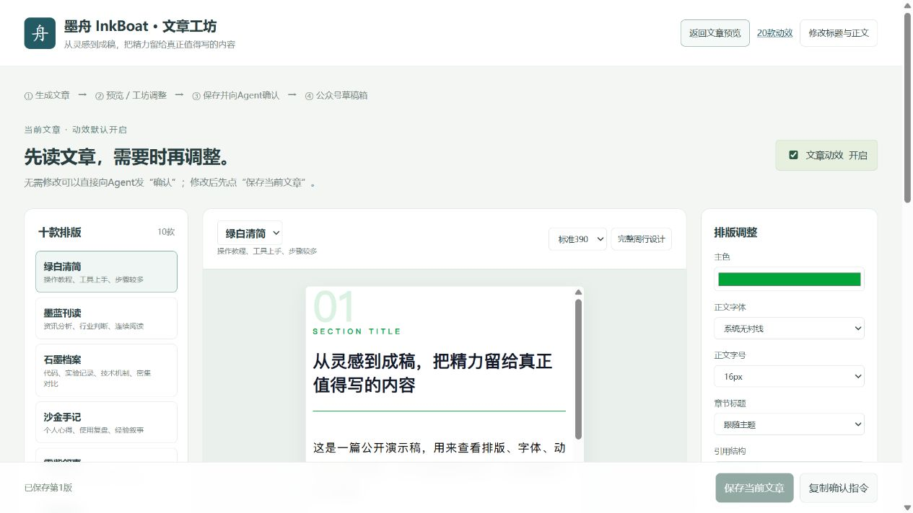
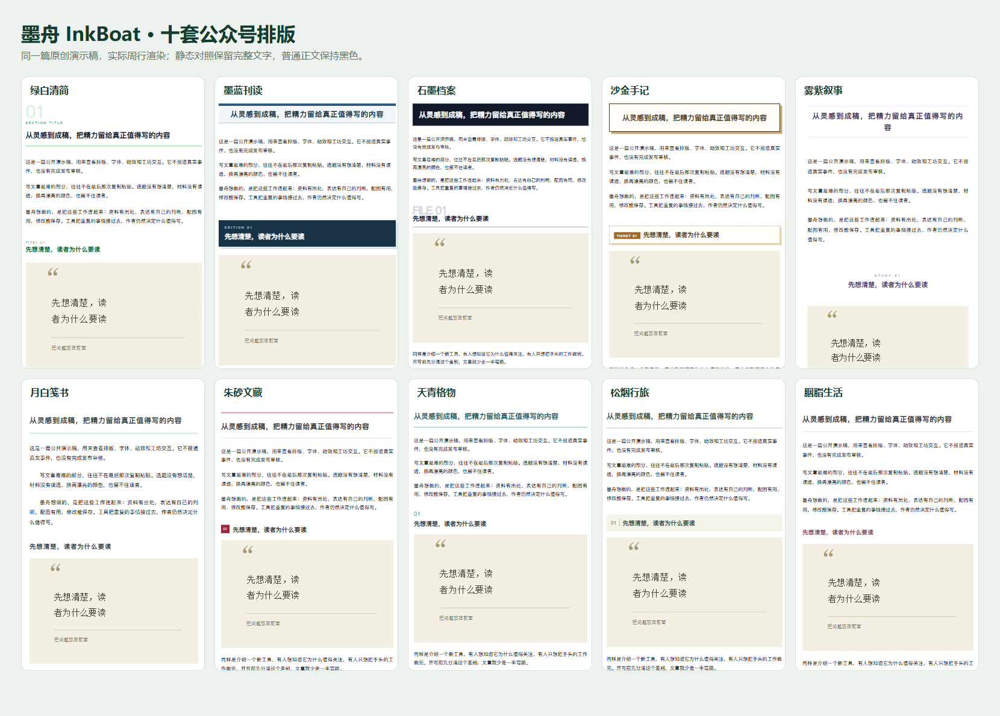
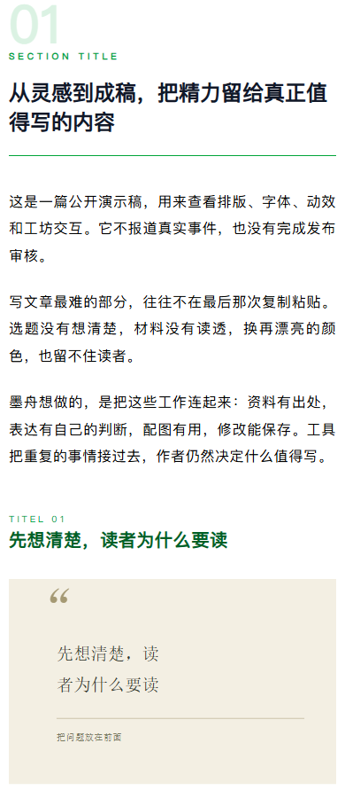

<div align="center">

# 墨舟 · InkBoat

### 把灵感，送到成稿的那一岸。

**一个面向 AI Agent 的公众号创作工作流：研究、写作、配图、排版、预览、学习与确认后入草稿。**


[快速开始](#快速开始) · [效果预览](#先看效果) · [完整文档](#文档导航) · [已知边界](#现在适合谁)

</div>

## 先看效果



*实际浏览器运行的本地工坊。截图使用本仓库原创演示稿，不含个人账号、登录态、真实新闻材料或私有文章。*

<table><tr><td width="50%"><p align="center">十套排版，按内容挑选</p></td><td width="50%"><p align="center">手机可读，普通正文统一黑色</p></td></tr></table>


*GIF 由本地浏览器连续截图录制，演示卡片回播与静态切换；不等同于所有微信客户端都已验收。详见[效果图说明](docs/SCREENSHOTS.md)。*

## 墨舟是什么

墨舟是一个 **Agent Skill 加本地工具集**。你用自然语言提出要求，Agent 读取规则、检索资料、写作与审稿，再调用脚本生成文章工坊、记录版本并执行检查。

它不是一个装好后独立运行的聊天机器人，也不是把提示词丢给模型就能一键群发的后台。搜索、浏览器与生图能力来自使用它的 Agent；脚本负责把成果、来源、图片、排版和确认状态连起来。

公开品牌叫 **墨舟 InkBoat**。为兼容已有安装与命令，skill 的目录及调用 ID 保留为 **`wechat-ai-autopilot`**。你可以直接说“用墨舟写一篇公众号”，也可以显式调用 `$wechat-ai-autopilot`。

### 一条内容链路


没有选题时，先提供五个有来源的候选；已有题目就直接围绕你的问题研究。文章学习与文风蒸馏有独立入口，不会为了读几篇文章而启动整个写作流程。

## 能做什么

| 能力 | 具体做法 | 交付与约束 |
| --- | --- | --- |
| 选题研究 | AIhot、公开网页、官方公告与相关平台线索 | 记录时间、出处、材料缺口；不编造热度 |
| 按读者问题写作 | 资讯、测评、案例、观点、使用方法等分别安排 | 不把所有题材套成同一提纲 |
| 文风与学习 | 现有卡兹克风格入口、文章内容学习、Writing DNA 蒸馏 | 不复制原句、身份与经历；成熟新风格进入个人库 |
| 双重语言审稿 | Humanizer → 独立 Lieflat Less AI Tone | 清理套话，保留事实、步骤和所选风格；不是 AI 作者鉴定 |
| 有用的插图 | 真实操作、结果、完整帖子或图表，搭配必要的概念图 | 不固定张数，不用生图伪造页面或证据 |
| 排版工坊 | 十套真实周行主题、字体、字号、间距、组件与正文修改 | 当前文章保存版本可恢复；模板与文章分别保存 |
| 内容动效 | 二十款本地设计，四类微信兼容推荐构图 | 默认按内容安排；预览可关闭；试验款另行验收 |
| 草稿传输 | 官方 API 或独立浏览器 DOM 两条通道 | 用户确认后执行；核对账号、图片、封面与重开结果 |
| 过程可核对 | 来源、事实映射、双审记录、图片哈希、质量报告 | 内部审稿文件与读者正文分开 |

### 十套排版

| 排版 | 适合内容 | 排版 | 适合内容 |
| --- | --- | --- | --- |
| 绿白清简 | 步骤、工具上手 | 月白笺书 | 文学、阅读与随笔 |
| 墨蓝刊读 | 消息与行业分析 | 朱砂文藏 | 人文、历史与文化 |
| 石墨档案 | 技术、代码与对照 | 天青格物 | 科普、知识与研究 |
| 沙金手记 | 经验与复盘 | 松烟行旅 | 行走、观察与记录 |
| 雾紫叙事 | 创意与产品故事 | 胭脂生活 | 生活、审美与日常 |

前五套来自已安装的[周行排版](https://github.com/Kianzzz/zhouxing-paiban-wx)，后五套是本项目携带的原创主题。适配器在生成时合并，不覆写周行安装目录。每套普通正文统一黑色，标题、强调与标志性设计保留主题颜色。

## 快速开始

### 1. 安装完整 Skill

下载本仓库，或到 [Releases 下载预发布安装包](https://github.com/LTY4869822/inkboat/releases/tag/v0.9.0-beta.3)。也可以使用 Git：

```bash
git clone https://github.com/LTY4869822/inkboat.git
cd inkboat
```

把 **整个** `skills/wechat-ai-autopilot` 文件夹复制到你的 Agent 支持的 skill 目录。不要只复制 `SKILL.md`。

| 宿主 | 常用目录 | 当前验证范围 |
| --- | --- | --- |
| Codex | `~/.codex/skills/wechat-ai-autopilot` | 主要开发及本机使用环境 |
| 项目内发现 | `.agents/skills/wechat-ai-autopilot` | 由宿主决定是否扫描 |
| Claude Code | `~/.claude/skills/wechat-ai-autopilot` | 提供安装约定，未完成全链路跨宿主验收 |
| 其他 Agent | 其文档声明的 skill 目录 | 需要工具能力适配，不能保证即装即用 |

例如在 macOS/Linux 终端中复制到 Codex：

```bash
mkdir -p ~/.codex/skills
cp -R skills/wechat-ai-autopilot ~/.codex/skills/
```

Windows PowerShell：

```powershell
$skillFolder = Join-Path $HOME '.codex/skills'
New-Item -ItemType Directory -Path $skillFolder -Force | Out-Null
Copy-Item -LiteralPath 'skills/wechat-ai-autopilot' -Destination $skillFolder -Recurse
```

已有同名安装时先备份、核对版本再替换；个人资料保留在工作目录。复制完成后开启新会话或按宿主方式刷新 skills。

### 2. 安装排版依赖并检查环境

必需的排版依赖是[zhouxing-paiban-wx](https://github.com/Kianzzz/zhouxing-paiban-wx)。按其说明安装仓库中的 skill 文件夹。墨舟不重新分发它的源码。

在仓库根目录运行：

```bash
python skills/wechat-ai-autopilot/scripts/onboard.py doctor --workspace .
```

把检查结果交给 Agent，它会确认宿主实际能搜索、截图和生图。没有内置生图时会询问是否配置及使用哪个厂商/模型；不需要则走无生图分支。**本地预览不需要公众号 AppSecret，也不需要先登录公众号。**

依赖及配置细节见[安装指南](docs/INSTALL.md)。

### 3. 直接对 Agent 说

```text
使用 $wechat-ai-autopilot（墨舟）。
写一篇最近七天值得普通用户关注的 AI 消息。
没有选题，先推荐五个让我选；篇幅 3000—4500 字，宋体。
截图要帮助解释事情经过，配图按内容需要安排。
先给我文章工坊预览，暂不上传。
```

已有题目时：

```text
用墨舟写一篇大模型对比。不要自己跑测试，找网上可追溯的同题案例。
重点比较相同任务的结果、失败与成本，不要只罗列参数。
篇幅按材料决定，先给预览。
```

定稿后：

```text
确认，使用工坊里已保存的第 3 版，上传到我已连接的公众号草稿箱。
保留这版的正文、字体、排版、配图与动效，不重新排版。
```

以上是自然语言工作流示例，不是会替你自动执行的命令。Agent 会检查本次真实工具、账号权限和确认状态。

## 不想先写文章？直接试工坊

安装周行依赖后，运行本地演示：

```bash
python scripts/demo.py --output .inkboat-demo --serve
```

打开终端输出的实际本机地址。演示会生成同一篇原创文章的十套排版和可保存工坊，不连接公众号，不生成“已核验新闻”，不授予任何上传权限。输出目录已存在文章时会拒绝覆盖；请换一个新目录。

若依赖在自定义位置：

```text
python scripts/demo.py --output .inkboat-demo-new --zhouxing PATH_TO_ZHOUXING --serve
```

`PATH_TO_ZHOUXING` 替换成实际安装的 skill 目录。工坊服务只绑定 `127.0.0.1`；停止终端进程即可关闭。

## 学习文章，也能学习文风

两种任务分开处理：

- **学习内容方法**：阅读全文，研究选题、论证、案例与读者收益，先交总结，再按授权合并规则。
- **新增写作风格**：通常需要至少二十篇完整文章，提炼五份文风文档、校准样本并写原创样稿，合格后注册到个人文风库。少量文章只做初步观察。

```text
用墨舟读取我提供的 30 篇文章，学习这个作者的表达方式。
不要照搬原句或身份。写一篇原创样稿验证，合格后加入我的文风选项。
```

个人语料与学习成果默认在你的工作目录，不上传本仓库。[详见文风与学习](docs/STYLES-AND-LEARNING.md)。

## 现在适合谁

适合愿意与 Agent 共同审稿、重视材料和可读性，并接受首次环境与账号配置的作者。**当前是公开 beta，不是“全平台、全账号、全自动、零人工”的正式承诺。**

- 本机主要验证环境为 Windows、Codex 桌面及 Chromium/Chrome；macOS/Linux 和其他 Agent 的端到端使用待进一步验证。
- 有网络或登录限制的平台会明确记录缺口。Agent-Reach 与 X Tweet Fetcher 是能力入口，不等于所有平台都已连通，更不等于都能截图。
- 官方 API 分支有模拟与契约测试；账号权限、白名单、真实写入和阅读效果仍须分别验收。
- 工坊及浏览器传稿有本机真实使用记录；统一 `deliver` 不承诺所有页面版本都零干预成功。
- 二十款本地动效中，四类有微信阅读页兼容经验，其余为试验款；实体微信客户端与深色模式不由桌面模拟替代。
- 默认止于草稿。正式发表要有当前明确授权，并可能需要管理员扫码、平台审核；提交申请不等于已发表。
- 本仓库只发布原版墨舟，**不包含独立教程版 Skill**。

详见[兼容与验收矩阵](docs/COMPATIBILITY.md)及[发布连接](docs/PUBLISHING.md)。

## 文档导航

| 文档 | 内容 |
| --- | --- |
| [安装与环境](docs/INSTALL.md) | Python、浏览器依赖、宿主差异、升级 |
| [从选题到交稿](docs/WORKFLOW.md) | 问答、证据、写作、配图、工坊与确认 |
| [文风与学习](docs/STYLES-AND-LEARNING.md) | 内容学习、Writing DNA、个人风格库 |
| [搜索与素材](docs/SEARCH-AND-VISUALS.md) | 平台接入、无账号分支、截图与生图 |
| [公众号连接与发布](docs/PUBLISHING.md) | 草稿通道、扫码、版本锁定、审核状态 |
| [架构与目录](docs/ARCHITECTURE.md) | 脚本职责、产物、状态与契约 |
| [兼容矩阵](docs/COMPATIBILITY.md) | 实测边界与待验收项 |
| [隐私与凭证](docs/PRIVACY.md) | 哪些数据留在本地、如何安全分享 |
| [常见问题](docs/FAQ.md) | 从缺依赖到草稿与动效排查 |
| [效果图说明](docs/SCREENSHOTS.md) | 截图来源、录制方法及验证范围 |
| [贡献指南](CONTRIBUTING.md) | 修改、测试、缺陷报告与提案 |
| [安全报告](SECURITY.md) | 私密报告方式与敏感信息处理 |

更细的 Agent 操作规则在 [`skills/wechat-ai-autopilot/references`](skills/wechat-ai-autopilot/references)，入口为 [`SKILL.md`](skills/wechat-ai-autopilot/SKILL.md)。

## 测试与打包

```bash
python -m pip install Pillow PyYAML
python -m unittest discover -s skills/wechat-ai-autopilot/tests -p "test_*.py"
node skills/wechat-ai-autopilot/tests/test_browser_start.cjs
node skills/wechat-ai-autopilot/tests/test_runtime_resolution.cjs
node skills/wechat-ai-autopilot/tests/test_studio_bootstrap.cjs
python skills/wechat-ai-autopilot/scripts/release_check.py --root skills/wechat-ai-autopilot
python scripts/check_public.py
python skills/wechat-ai-autopilot/scripts/package_skill.py --output dist/wechat-ai-autopilot.zip
```

核心 Python 编排使用标准库；上面的 Pillow、PyYAML 用于部分验证及开发。浏览器链路另需 Node、Playwright、pngjs 和浏览器。测试通过不证明文章质量、真实平台权限或微信手机效果。打包输出只含 skill 目录和文件哈希，不把仓库文档、演示工作区或个人账户装进 skill。

## 致谢与许可证

原创编排、适配与主题资源以 [MIT](LICENSE) 发布。嵌入资源保留各自许可证与来源，完整清单见 [第三方说明](skills/wechat-ai-autopilot/THIRD_PARTY_NOTICES.md)。感谢：

- [周行排版](https://github.com/Kianzzz/zhouxing-paiban-wx)：实际公众号排版引擎，独立安装。
- [Humanizer](https://github.com/blader/humanizer)、[Lieflat Less AI Tone](https://github.com/larashero3-dotcom/lieflat-less-ai-tone)：写后语言审稿规则。
- [Writing DNA](https://github.com/larashero3-dotcom/writing-dna-skill)：文风学习流程。
- [Agent-Reach](https://github.com/Panniantong/Agent-Reach)、[X Tweet Fetcher](https://github.com/ythx-101/x-tweet-fetcher)：公开资料与平台素材读取入口。
- [khazix-skills](https://github.com/KKKKhazix/khazix-skills)：卡兹克写作风格入口参考，按宿主安装状态使用，不宣称作者为本项目背书。

项目 MIT 许可不自动授予第三方文章、截图、商标或个人语料的再分发权。使用素材时仍应核对来源与使用依据。
